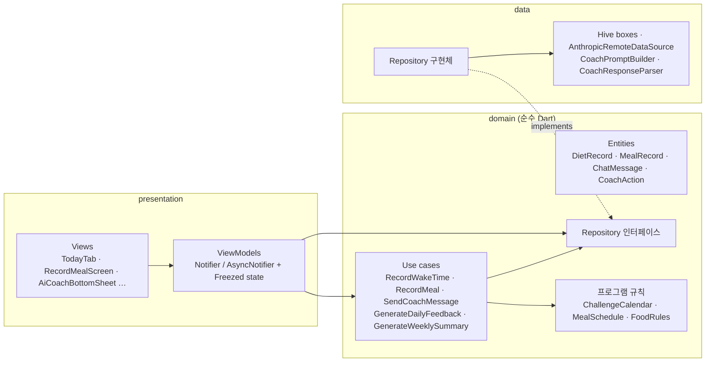

<p align="center">
  
</p>

<h1 align="center">Switch-On Diet</h1>

<p align="center">
  28일 <b>스위치온 다이어트</b> 챌린지를 위한 Flutter 앱입니다. 기상 시간 기준 식사 시간대,
  실시간 공복 타이머, 주차별 식단 가이드, LLM 기반 AI 코치를 제공합니다.
</p>

<p align="center">
  <a href="README.md">English</a> · <b>한국어</b>
</p>

<p align="center">
  
  
  
  
  
</p>

---

## 만든 이유

스위치온 다이어트는 규칙이 엄격한 4주 프로그램입니다. 저녁부터 아침까지 14시간 공복, 기상 시간 기준으로 정해진
네 번의 식사, 주차마다 늘어나는 허용 식품, 후반 주차의 24시간 단식이 있습니다. PDF만 보고 지키기는 어려워서,
이 규칙을 하루 타임라인으로 바꾸고, 식사마다 이번 주 규칙에 맞는지 판정하고, 지금 몇 주차인지 아는 코치를 붙였습니다.

UI는 한국어이고, 모든 시간은 JST(Asia/Tokyo) 기준으로 계산합니다.

## 주요 기능

**오늘**
- **단계 카드**: 현재 단계의 제목과 한 줄 가이드, 오늘의 달성률을 보여 줍니다.
- **기상 기록**: 하루 안에 아직 먹을 수 있는 끼니만 만들어집니다. 9시 전에 일어나면 네 끼 모두, 늦을수록 줄어들고,
  17시 이후에는 만들어지지 않습니다. 각 끼니의 시간대는 기상 후 +30–90분, +210–270분, +390–450분, +570–630분입니다.
  기상을 기록하면 어젯밤 수면 시간도 보여 주고, 6시간 미만이면 경고합니다.
- **실시간 공복 타이머**: 14시간 목표 대비 현재 공복 시간을 보여 줍니다.
- **데일리 미션**: 물 2L, 영양제, 고강도 운동, 수면 체크리스트입니다.
- **텍스트 식사 입력**: 먹은 음식을 적으면 AI가 이번 주 식품 목록을 기준으로 `허용`, `주의`, `금지`를 판정하고
  한 줄 코멘트를 줍니다. 이유를 적고 끼니를 건너뛸 수도 있고, 시간대가 지나서 기록하면 늦은 이유를 묻습니다.
- **취침 기록**: 어젯밤 취침을 기록하지 않았으면 배너로 알려 줍니다.

**캘린더**
- 하루 결과별로 색이 다른 28일 그리드, 전체 진행률, 성장 배지를 보여 줍니다.
- 날짜를 누르면 그날의 식사, 규칙, AI 피드백을 볼 수 있고, 기록하지 못한 날은 나중에 채울 수 있습니다.

**식단 가이드**
- 단계별(1–3일, 4–7일, 2–4주차) 규칙을 보여 주고, 오늘 해당하는 단계를 강조합니다.

**마이페이지**
- 전체 기간의 식단·수면 기록(기상·취침 시간, 미션 달성, 식사)을 볼 수 있습니다.
- 하루 피드백과 주간 요약 카드가 쌓인 AI 코치 히스토리를 볼 수 있습니다.
- 표시 이름과 챌린지 시작일 설정, 전체 데이터 초기화를 제공합니다.

**AI 코치**
- 채팅 시트를 열면 오늘 상태(빠진 끼니, 체크 안 한 미션, 어제 점수)로 만든 인사가 먼저 나옵니다.
  기기 안에서 만들기 때문에 API를 호출하기 전에도 동작하고, 추천 질문 칩도 있습니다.
- 요청마다 현재 일차와 주차, 식사 상태, 이번 주 허용·금지 식품, 어제 요약을 함께 보냅니다.
- **채팅으로 기록**: "7시에 일어났어요", "점심 걸렀어요", "11시에 잤어요"라고 말하면 기록이 바로 갱신됩니다
  ([주요 설계 판단](#주요-설계-판단) 참고).
- **자동 리뷰**: 하루 피드백은 23:00–23:59, 주간 요약은 7·14·21·28일차 17:00–19:00에 생성됩니다.
  앱을 열거나 다시 활성화할 때 실행되므로 서버가 필요 없습니다.

## 아키텍처

클린 아키텍처 계층 위에 MVVM을 얹은 구조입니다. 코드는 기능별로 묶고, 각 기능은 최대 세 개의 계층을 가집니다.

- **presentation**: 위젯(*View*)과 Riverpod `Notifier` / `AsyncNotifier` 클래스(*ViewModel*)입니다.
  View는 불변 상태를 그리고 사용자 이벤트만 넘기며, 저장소에 직접 접근하지 않습니다.
- **domain**: Freezed 엔티티, Repository 인터페이스, UseCase, 프로그램 규칙입니다. 순수 Dart이며
  Flutter, Riverpod, Hive, HTTP를 import하지 않습니다.
- **data**: Hive 모델과 매퍼, Repository 구현체, 데이터 소스(Hive 박스, Anthropic Messages API)입니다.



**의존성 규칙.** 의존성은 항상 `domain`을 향합니다. `domain`은 다른 계층을 import하지 않고, `data`는
`presentation`을 import하지 않으며, `core`는 기능 코드를 import하지 않습니다. 의존성 연결은 기능마다
`<feature>_providers.dart` 한 파일에서 하고, `lib/app/bootstrap.dart`가 Hive 박스를 열어 provider override로 넘깁니다.
규칙을 어기는 import가 있으면 `scripts/check_quality.sh`가 실패합니다.

```
lib/
├── main.dart                  # bootstrap() 후 ProviderScope(overrides) → SwitchOnDietApp
├── app/                       # 앱 루트, bootstrap, 메인 탭 셸
├── core/
│   ├── config/                # API 키: --dart-define, 없으면 .env
│   ├── di/                    # clockProvider, httpClientProvider, anthropicApiKeyProvider
│   ├── theme/                 # 컬러 토큰, ThemeData
│   ├── time/                  # Clock / JstClock, JST 변환과 포맷
│   └── utils/                 # TimeValidator (기상·취침 규칙)
└── features/
    ├── program/               # domain: ChallengeCalendar, MealSchedule, FoodRules, ProgramPhase · 식단 가이드 탭
    ├── diet_record/           # 일별 기록: 오늘, 캘린더, 식단 기록, 지난 날짜 입력
    ├── meal/                  # 식사 기록과 AI 판정 · 식사 알림
    ├── coach/                 # AI 코치 채팅, 채팅 히스토리, LLM 연동
    ├── analysis/              # 하루·주간 자동 리뷰 (UseCase만)
    └── settings/              # 온보딩, 마이페이지, 설정, 초기화
```

**요청 하나의 흐름: 식사 기록.**

1. 사용자가 *저장*을 누르면 `RecordMealScreen`(View)이 `RecordMealViewModel.save()`를 호출합니다.
2. ViewModel이 입력값을 `RecordMeal` UseCase에 넘깁니다.
3. `RecordMeal`은 먼저 `DietRecordRepository`로 식사를 저장해서 AI 호출이 실패해도 기록이 남게 하고,
   그다음 `AiCoachRepository.analyzeMeal`에 판정을 요청합니다.
4. `RemoteAiCoachRepository`가 `CoachPromptBuilder`로 프롬프트를 만들고, `AnthropicRemoteDataSource`로 보낸 뒤,
   `CoachResponseParser`로 응답을 해석합니다. HTTP 오류는 이 경계에서 타입이 있는 `AiFailure`로 바뀝니다.
5. 판정 결과가 기록에 다시 저장됩니다. Hive 박스가 변경을 알리면 `dietRecordsProvider`가 새 값을 내고,
   이를 구독하는 ViewModel(오늘, 캘린더, 기록)이 모두 다시 계산됩니다. 화면에 새로고침을 따로 알릴 필요가 없습니다.
6. `save()`는 sealed 타입 `RecordMealOutcome`(`analyzed`, `analysisFailed`, `notFound`)을 돌려주고,
   View가 이를 스낵바나 다이얼로그로 보여 줍니다.

**Riverpod `Notifier`와 Freezed를 쓴 이유.**

- Provider가 DI 컨테이너 역할도 합니다. 시계, HTTP 클라이언트, Hive 박스까지 모든 의존성을 테스트에서
  `overrideWithValue`로 바꿀 수 있고, `BuildContext`가 필요 없습니다.
- `AsyncNotifier`는 로딩과 에러를 `AsyncValue`로 노출하므로 ViewModel은 데이터 상태만 다루면 됩니다.
  `autoDispose`와 `family`로 화면별·항목별 인스턴스를 만듭니다(예: 날짜별 채팅 스레드).
- Provider는 직접 작성했습니다. `riverpod_generator`는 `hive_generator`가 지원하는 것보다 새 analyzer가 필요하고,
  직접 쓰는 편이 의존성 그래프를 읽기도 쉽습니다.
- Freezed로 값 비교가 되는 불변 엔티티와 상태(테스트에서 레코드 전체를 비교), 갱신용 `copyWith`,
  `switch`로 빠짐없이 분기할 수 있는 sealed union(`CoachAction`, `RecordMealOutcome`)을 만듭니다.
- UseCase는 맡을 로직이 있을 때만 만듭니다(여러 단계의 흐름, 시간대 조건, 여러 Repository를 함께 쓰는 작업).
  단순 조회와 저장은 ViewModel이 Repository를 바로 호출합니다.
  이 판단들은 [`docs/ARCHITECTURE_DECISIONS.md`](docs/ARCHITECTURE_DECISIONS.md)에 정리했습니다.

**저장과 시간.**

- Hive, 로컬 전용입니다. 일별 기록은 일차(1–28)를 키로, 설정은 키 하나에, 채팅 스레드는 날짜를 키로 JSON 문자열로
  저장합니다. Hive 모델은 기존 type id와 필드 번호를 유지하고, 기존 어댑터로 쓴 박스를 여는 테스트로 저장 데이터가
  그대로 읽히는지 확인합니다.
- "현재 시각"이 필요한 곳은 모두 `Clock`을 주입받습니다. `JstClock`은 `timezone` 데이터베이스(Asia/Tokyo)를 쓰고,
  없으면 UTC+9로 대체합니다. 테스트는 고정 시계를 씁니다.

자세한 설계 문서는 [`docs/ARCHITECTURE.ko.md`](docs/ARCHITECTURE.ko.md), 앱이 구현한 다이어트 규칙은
[`docs/DIET_PROGRAM.ko.md`](docs/DIET_PROGRAM.ko.md)에 있습니다.

## 기술 스택

| 영역 | 선택 |
|---|---|
| 프레임워크 | Flutter 3.35 · Dart 3.8+ · Material 3 |
| 아키텍처 | MVVM + 클린 아키텍처, 기능별 폴더 |
| 상태 / DI | flutter_riverpod 2.x (`Notifier`, `AsyncNotifier`, provider override) |
| 모델 | freezed (엔티티, 화면 상태, sealed union) |
| 로컬 저장소 | hive · hive_flutter · hive_generator + build_runner |
| AI | `http`로 Anthropic Messages API 호출 |
| 시간 | timezone (Asia/Tokyo 고정) · intl |
| 알림 | flutter_local_notifications. 시작 시 초기화되고, 식사 알림 스케줄러는 `MealReminderService`에 구현되어 있지만 아직 UI와 연결하지 않았습니다. |
| 설정 | `--dart-define` 또는 flutter_dotenv (`.env`) |
| 다국어 | flutter_localizations (`ko_KR`) |
| 품질 | flutter_lints + strict analyzer 모드 · 단위 테스트 · 계층 규칙 검사 |

## 주요 설계 판단

- **식사 시간은 고정 시각이 아니라 기상 기준 오프셋입니다.** `MealSchedule`이 각 끼니의 시간대를 기상 후 몇 분으로
  정의하고, 타임라인 카드, 추천 시간, 놓친 끼니 상태가 모두 이 표 하나에서 계산됩니다.
- **늦게 일어난 날에도 달성률이 공정합니다.** 늦게 일어나면 하루 안에 가능한 끼니만 만들어지고, `DietRecord.score`는
  건너뛴 끼니를 빼고 계산합니다. 실제로 먹을 수 있었던 끼니 기준의 달성률입니다.
- **채팅이 곧 기록입니다.** 시스템 프롬프트에서 모델에게 `<ACTION>MEAL:아침:계란, 샐러드</ACTION>` 같은 태그를
  답변에 붙이게 합니다. `CoachActionParser`가 태그를 sealed `CoachAction` 목록으로 바꾸고 화면에 보이는 텍스트에서
  지우며, `ApplyCoachActions` UseCase가 기상·식사·건너뛰기·취침 이벤트를 저장합니다.
- **느슨한 응답도 해석합니다.** 식사 판정은 `STATUS:`/`FEEDBACK:` 줄에서 읽고, 없으면 키워드로, 그래도 안 되면
  안전한 기본값을 씁니다. 모델 응답 형식이 틀려도 UI가 깨지지 않습니다.
- **기능별 토큰 예산.** AI 기능마다 `max_tokens`를 따로 둡니다(식사 판정 500 ~ 주간 요약 3,500).
  프롬프트에는 전체 기록 대신 오늘 상태와 어제의 한 줄 요약만 보냅니다.
- **백엔드 없는 정기 리뷰.** 하루·주간 분석은 앱을 열거나 다시 활성화할 때 JST 시간대를 확인해 실행합니다.
  리뷰는 한 번만 실행되고 결과는 그날 기록에 저장됩니다.
- **로컬 우선.** 모든 기록은 기기에만 남고, 밖으로 나가는 것은 AI 요청뿐입니다. API 키는 저장소에 두지 않고
  빌드·실행 시 주입합니다.
- **엄격한 정적 분석.** `strict-casts`, `strict-inference`, `strict-raw-types`를 켜고, 사용하지 않는 코드, 빠진 `const`,
  불필요한 null 체크를 analyzer *에러*로 다룹니다. 파일은 500줄 이하로 유지하고, `scripts/check_quality.sh`가 계층 의존성
  규칙도 검사합니다([`docs/CODING_GUIDELINES.md`](docs/CODING_GUIDELINES.md) 참고).

## 시작하기

필요 환경: **Flutter 3.35 이상**(Dart 3.8+), iOS는 Xcode, Android는 Android Studio.

```bash
git clone https://github.com/somi-jeong/switch-on-diet-flutter.git
cd switch-on-diet-flutter

cp .env.example .env          # 필수: .env가 asset으로 포함됩니다 (키는 비워 둬도 됩니다)
flutter pub get

# AI 코치를 켜고 실행
flutter run --dart-define=ANTHROPIC_API_KEY=sk-ant-...
```

- 키가 없어도 앱은 실행됩니다. 기록, 캘린더, 가이드, 히스토리는 모두 동작하고, AI 기능은 응답 대신 오류 메시지를
  보여 줍니다. 네트워크 오류나 사용량 제한 같은 API 실패는 재시도 버튼이 있는 오류 다이얼로그로 안내합니다.
- 키를 `.env`(`ANTHROPIC_API_KEY=...`)에 넣어도 됩니다. `--dart-define` 값이 우선합니다.
- 지금은 기기에서 API를 바로 호출합니다. 실제 배포 시에는 키가 앱에 포함되지 않도록 앞단에 간단한 프록시를 두세요.
- Hive 모델이나 Freezed 클래스를 바꾼 뒤에는 `dart run build_runner build --delete-conflicting-outputs`로 코드를 다시
  생성하세요. 생성된 `*.g.dart`, `*.freezed.dart` 파일은 커밋되어 있습니다.
- `make help`로 단축 명령(`make setup`, `make run ANTHROPIC_API_KEY=...`, `make check`)을 볼 수 있습니다.

주 타깃은 iOS입니다. 웹 빌드도 동작하며(Hive가 IndexedDB 사용), 위 스크린샷은 웹 빌드에서 찍었습니다.

## 프로젝트 구조

```
lib/
├── main.dart, app/            # bootstrap, 앱 루트, 탭 셸
├── core/                      # 설정, DI, 테마, Clock / JST, 공용 유틸
└── features/<feature>/
    ├── domain/                # 엔티티, Repository 인터페이스, UseCase
    ├── data/                  # Hive 모델 + 매퍼, 데이터 소스, Repository 구현
    ├── presentation/          # View와 ViewModel
    └── <feature>_providers.dart
test/                          # lib/features와 같은 구조, fake와 Hive 헬퍼는 test/helpers
docs/                          # 아키텍처, 설계 결정, 코딩 가이드, 다이어트 규칙, 스크린샷
scripts/                       # check_quality.sh, format_all.sh
```

## 테스트

```bash
flutter analyze   # 이슈 없음
flutter test      # 단위 테스트 85개
make check        # analyze + 파일 크기 + 계층 의존성 규칙
```

| 계층 | 테스트 대상 | 방법 |
|---|---|---|
| domain | 프로그램 규칙, 엔티티 헬퍼, UseCase(기상 시 끼니 배치, 식사 기록, 코치 액션, 정기 리뷰, 인사) | 인메모리 Repository와 `FixedClock` |
| presentation | ViewModel과 파생 상태(오늘, 식사 기록, 코치 채팅, 히스토리, 캘린더, 설정) | Repository와 시계를 override한 `ProviderContainer` |
| data | Hive Repository, 매퍼, 채팅 저장, Anthropic 클라이언트, 프롬프트·응답 파싱 | 임시 디렉터리의 Hive, 기존 어댑터로 만든 박스 fixture, `http` `MockClient` |

위젯 테스트는 아직 없습니다. View는 상태를 배치하기만 하고, 그 뒤의 로직은 ViewModel 테스트로 검증합니다.

## 라이선스

[MIT](LICENSE) © 2026 Somi Jeong

> 이 프로젝트는 스위치온 다이어트 프로그램 제작자와 관련이 없으며, 의학적 조언을 제공하지 않습니다.
