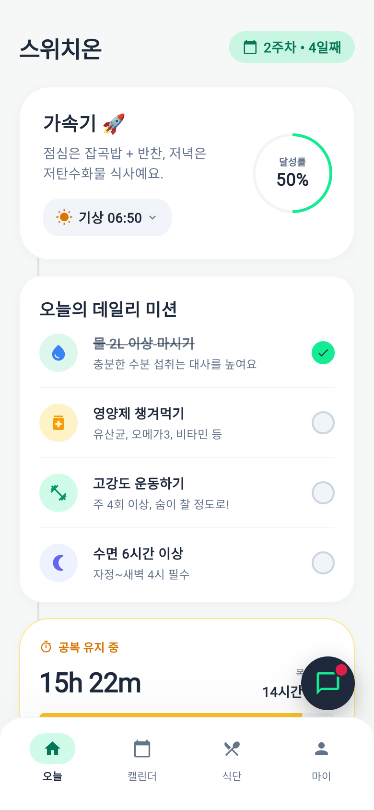
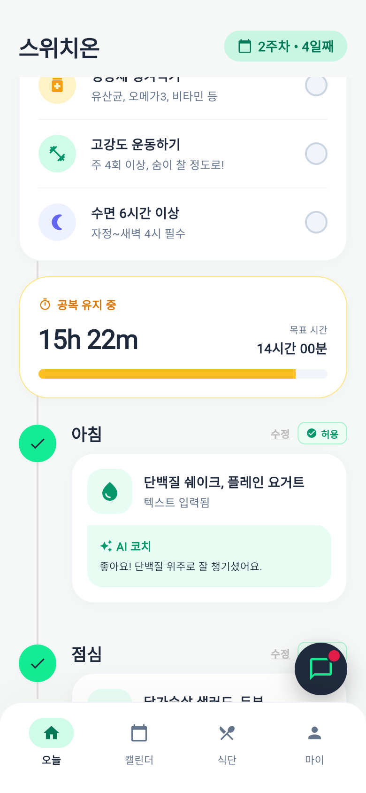
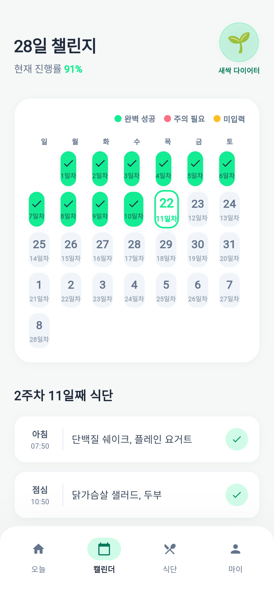
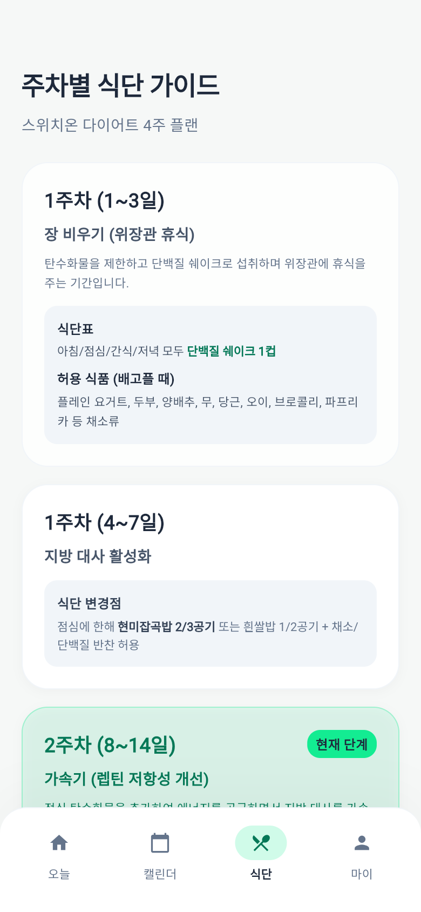
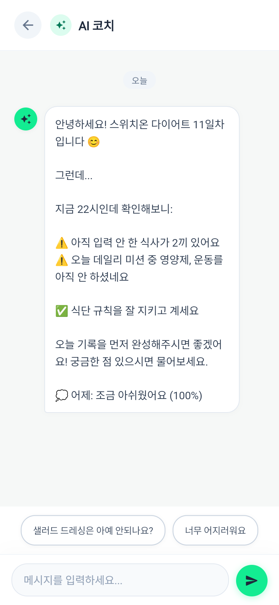
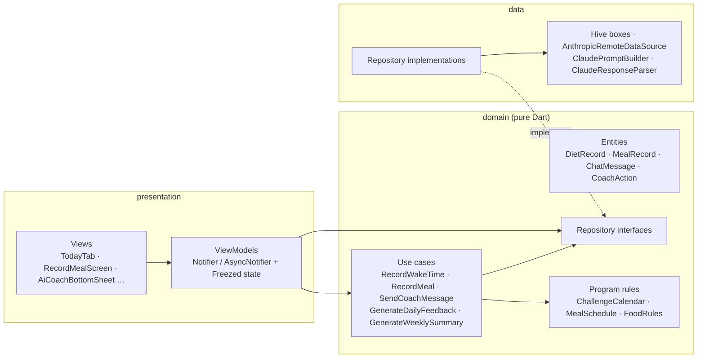

<p align="center">
  
</p>

<h1 align="center">Switch-On Diet</h1>

<p align="center">
  A Flutter app for the 28-day <b>Switch-On Diet</b> challenge: meal windows timed from when you wake up,
  a live fasting timer, a week-by-week food guide, and an AI coach built on the Claude API.
</p>

<p align="center">
  <a href="#english">English</a> · <a href="#한국어">한국어</a> · <a href="#日本語">日本語</a>
</p>

<p align="center">
  
  
  
  
  
</p>

---

## English

### Why

The Switch-On Diet is a 4-week program with strict rules: 14 hours of fasting between dinner and breakfast,
four meals at fixed offsets from waking, a list of allowed foods that grows each week, and 24-hour fasts in
the later weeks. Those rules are hard to follow from a PDF. This app turns them into a daily timeline,
checks each meal against the current week's rules, and adds a coach that knows where you are in the program.

The UI is in Korean, and all times are calculated in JST (Asia/Tokyo).

### Features

**Today**
- **Phase card**: a title and one-line guide for the current phase of the plan, plus the day's achievement rate.
- **Wake-up logging** creates the meals that still fit in the day. You get all four if you wake before 09:00,
  fewer as it gets later, and none after 17:00. Each meal gets a time window based on when you woke up:
  +30–90, +210–270, +390–450 and +570–630 minutes. When you log a wake-up, the app also shows last night's
  sleep time and warns you if it was under six hours.
- **Live fasting timer** that compares your fast against the 14-hour target.
- **Daily missions** checklist: 2 L of water, supplements, high-intensity exercise and sleep.
- **Text meal input**: describe what you ate. The AI rates the meal `ALLOWED`, `WARNING` or `FORBIDDEN`
  against the current week's food list and adds a one-line comment. You can also skip a meal with a reason,
  and logging a meal after its window asks why it was late.
- **Bedtime logging**, including a banner that asks for last night's bedtime if you forgot to log it.

**Calendar**
- A 28-day grid colour-coded by daily result, plus overall progress and a growth badge.
- A day-detail panel with the meals, daily rules and AI feedback for any day. You can also fill in missed days later.

**Diet guide**
- Rules for each phase of the plan (days 1–3, 4–7 and weeks 2–4), with today's phase highlighted.

**My page**
- Diet and sleep history across all days, with wake-up and bed times, mission completion and meals.
- AI coach history with daily feedback and weekly summary cards.
- Settings for display name and challenge start date, plus a full data reset.

**AI coach (Claude API)**
- A chat sheet that opens with a greeting built locally from today's state (missing meals, unchecked
  missions, yesterday's score), so it works before any API call. Suggested-question chips are included.
- Each request includes the current day and week, the meal status, the week's allowed and forbidden
  foods, and a short summary of yesterday.
- **Logging by chat**: tell the coach "I woke up at 7", "I skipped lunch" or "I went to bed at 11" and it updates your records directly
  (see [Notable engineering decisions](#notable-engineering-decisions)).
- **Automatic reviews**: a daily feedback runs between 23:00 and 23:59, and a weekly summary runs between 17:00 and 19:00 on days 7, 14, 21 and 28.
  Both are triggered when the app opens or resumes, so no server is needed.

### Architecture

The app follows MVVM on top of a Clean Architecture split. Code is grouped by feature, and every
feature has up to three layers:

- **presentation**: widgets (the *views*) and Riverpod `Notifier` / `AsyncNotifier` classes (the
  *view models*). Views render an immutable state and forward user events; they never touch storage.
- **domain**: Freezed entities, repository interfaces, use cases and the program rules. Pure Dart:
  no Flutter, Riverpod, Hive or HTTP imports.
- **data**: Hive models and mappers, repository implementations and data sources (Hive boxes, the
  Anthropic Messages API).



**Dependency rule.** Dependencies point towards `domain`. `domain` imports nothing from the other
layers, `data` never imports `presentation`, and `core` never imports a feature. Wiring happens in
one `<feature>_providers.dart` file per feature, and `lib/app/bootstrap.dart` opens the Hive boxes
and passes them in as provider overrides. `scripts/check_quality.sh` fails if an import breaks the rule.

```
lib/
├── main.dart                  # bootstrap(), then ProviderScope(overrides) → SwitchOnDietApp
├── app/                       # app root, bootstrap, main tab shell
├── core/
│   ├── config/                # API key: --dart-define, then .env
│   ├── di/                    # clockProvider, httpClientProvider, anthropicApiKeyProvider
│   ├── theme/                 # colour tokens, ThemeData
│   ├── time/                  # Clock / JstClock, Jst conversion and formatting
│   └── utils/                 # TimeValidator (wake-up / bedtime rules)
└── features/
    ├── program/               # domain: ChallengeCalendar, MealSchedule, FoodRules, ProgramPhase · diet guide tab
    ├── diet_record/           # day records: Today, Calendar, diet history, past-day backfill
    ├── meal/                  # recording a meal and its AI verdict · meal reminders
    ├── coach/                 # AI coach chat, chat history, the Claude integration
    ├── analysis/              # scheduled daily and weekly reviews (use cases only)
    └── settings/              # onboarding, my page, settings, reset
```

**A request, end to end: logging a meal.**

1. `RecordMealScreen` (view) calls `RecordMealViewModel.save()` when the user taps *save*.
2. The view model hands the form values to the `RecordMeal` use case.
3. `RecordMeal` saves the meal through `DietRecordRepository` first, so the entry survives an AI failure,
   then asks `AiCoachRepository.analyzeMeal` for a verdict.
4. `ClaudeAiCoachRepository` builds the prompt with `ClaudePromptBuilder`, sends it through
   `AnthropicRemoteDataSource`, and parses the reply with `ClaudeResponseParser`. HTTP errors become
   typed `AiFailure`s at this boundary.
5. The verdict is written back to the record. The Hive box emits a change, `dietRecordsProvider`
   re-emits, and every view model that watches it (Today, Calendar, history) rebuilds. No screen has to be told to refresh.
6. `save()` returns a sealed `RecordMealOutcome` (`analyzed`, `analysisFailed`, `notFound`), which the
   view turns into a snackbar or a dialog.

**Why Riverpod `Notifier` and Freezed.**

- Providers double as the DI container. Every dependency, including the clock, the HTTP client and the
  Hive boxes, can be replaced with `overrideWithValue` in a test, and nothing needs a `BuildContext`.
- `AsyncNotifier` exposes loading and error as `AsyncValue`, so view models only describe the data
  state. `autoDispose` and `family` give per-screen and per-item instances, for example one chat
  thread per date.
- Providers are written by hand. `riverpod_generator` would need a newer analyzer than
  `hive_generator` supports, and the manual form keeps the dependency graph easy to read.
- Freezed gives immutable entities and states with value equality (tests compare whole records),
  `copyWith` for updates, and sealed unions (`CoachAction`, `RecordMealOutcome`) that `switch`
  handles exhaustively.
- Use cases exist only where there is logic to own: multi-step flows, time windows, cross-repository
  work. Simple reads and writes go from the view model straight to the repository.
  [`docs/ARCHITECTURE_DECISIONS.md`](docs/ARCHITECTURE_DECISIONS.md) records these choices.

**Persistence and time.**

- Hive, local only. Day records are keyed by day index (1–28), settings live under one key, and chat
  threads are JSON strings keyed by date. The Hive models keep the original type ids and field
  numbers. A test opens boxes written by the original adapters to make sure stored data still loads.
- Everything that needs "now" receives a `Clock`. `JstClock` reads the `timezone` database
  (Asia/Tokyo) and falls back to UTC+9. Tests use a fixed clock.

A Korean design document is in [`docs/ARCHITECTURE.ko.md`](docs/ARCHITECTURE.ko.md).
The diet rules the app encodes are summarised in [`docs/DIET_PROGRAM.ko.md`](docs/DIET_PROGRAM.ko.md).

### Tech stack

| Area | Choice |
|---|---|
| Framework | Flutter 3.35 · Dart 3.8+ · Material 3 |
| Architecture | MVVM + Clean Architecture, feature-first folders |
| State / DI | flutter_riverpod 2.x (`Notifier`, `AsyncNotifier`, provider overrides) |
| Models | freezed (entities, view states, sealed unions) |
| Local storage | hive · hive_flutter · hive_generator + build_runner |
| AI | Anthropic Messages API over `http` (model `claude-haiku-4-5`) |
| Time | timezone (fixed Asia/Tokyo) · intl |
| Notifications | flutter_local_notifications. It is initialised at startup, and a meal-reminder scheduler is implemented in `MealReminderService` but not yet connected to the UI. |
| Config | `--dart-define` or flutter_dotenv (`.env`) |
| i18n | flutter_localizations (`ko_KR`) |
| Quality | flutter_lints plus strict analyzer modes · unit tests · layer-rule check |

### Notable engineering decisions

- **Meal times are offsets from waking, not fixed clock times.** `MealSchedule` defines each meal window
  as minutes after waking. Timeline cards, recommended times and the missed-meal states are all calculated from that one table.
- **Achievement is fair to late days.** A late wake-up only creates the meals that still fit in the day, and
  `DietRecord.score` ignores skipped meals. Your rate reflects the meals you could actually have eaten.
- **The chat also logs records.** The system prompt asks Claude to add tags like `<ACTION>MEAL:아침:계란, 샐러드</ACTION>`
  to its reply. `CoachActionParser` turns the tags into a sealed `CoachAction` list and removes them from the
  visible text, and the `ApplyCoachActions` use case saves the wake, meal, skip or sleep events.
- **Parsing tolerates loose output.** Meal verdicts are read from `STATUS:`/`FEEDBACK:` lines.
  If those are missing, the parser falls back to keywords and then to a safe default, so a malformed model reply
  never breaks the UI.
- **Token budgets per use case.** Each AI feature has its own `max_tokens` limit, from 500 for meal checks to
  3,500 for weekly summaries. The prompt sends today's state and a one-line summary of yesterday instead of
  the full history.
- **Scheduled reviews without a backend.** Daily and weekly analyses check the JST time window when the app opens
  or resumes. Each review runs once, and the result is saved on that day's record.
- **Local-first.** Every record stays on the device. Only the AI requests leave it, and the API key is injected
  at build or run time instead of being stored in the repo.
- **Strict analysis.** `strict-casts`, `strict-inference` and `strict-raw-types` are on, and unused code, missing `const`
  and redundant null checks are analyzer *errors*. Files stay under 500 lines, and `scripts/check_quality.sh`
  also checks the layer dependency rule (see [`docs/CODING_GUIDELINES.md`](docs/CODING_GUIDELINES.md)).

### Getting started

Requirements: **Flutter 3.35+** (Dart 3.8+), Xcode for iOS, or Android Studio for Android.

```bash
git clone https://github.com/somi-jeong/switch-on-diet-flutter.git
cd switch-on-diet-flutter

cp .env.example .env          # required: .env is bundled as an asset (the key may stay empty)
flutter pub get

# Run with the AI coach enabled
flutter run --dart-define=ANTHROPIC_API_KEY=sk-ant-...
```

- Without a key the app still runs. Tracking, calendar, guide and history all work, and the AI features
  show an error message instead of a response. API failures such as network errors or rate limits
  open an error dialog with a retry button.
- You can also put the key in `.env` (`ANTHROPIC_API_KEY=...`). A `--dart-define` value takes precedence.
- The app calls the API directly from the device. For a public release, put a small proxy in front of it
  so the key is never shipped in the binary.
- After changing a Hive model or a Freezed class, regenerate code with `dart run build_runner build --delete-conflicting-outputs`.
  The generated `*.g.dart` and `*.freezed.dart` files are committed.
- `make help` lists shortcuts (`make setup`, `make run ANTHROPIC_API_KEY=...`, `make check`).

iOS is the main target. The web build also runs (Hive uses IndexedDB), and the screenshots above were taken from it.

### Project structure

```
lib/
├── main.dart, app/            # bootstrap, app root, tab shell
├── core/                      # config, DI, theme, Clock / JST, shared utils
└── features/<feature>/
    ├── domain/                # entities, repository interfaces, use cases
    ├── data/                  # Hive models + mappers, data sources, repositories
    ├── presentation/          # views and view models
    └── <feature>_providers.dart
test/                          # mirrors lib/features; fakes and Hive helpers in test/helpers
docs/                          # architecture, decisions, coding guidelines, diet program, screenshots
scripts/                       # check_quality.sh, format_all.sh
```

### Testing

```bash
flutter analyze   # no issues
flutter test      # 85 unit tests
make check        # analyze + file size + layer dependency rule
```

| Layer | What is tested | How |
|---|---|---|
| domain | program rules, entity helpers, use cases (wake-up layout, meal recording, coach actions, scheduled reviews, greeting) | in-memory repositories and a `FixedClock` |
| presentation | view models and derived state (Today, record meal, coach chat, history, calendar, settings) | a `ProviderContainer` with overridden repositories and clock |
| data | Hive repositories, mappers, chat storage, the Anthropic client, prompt/response parsing | Hive in a temp directory, a box fixture written by the original adapters, `http` `MockClient` |

There are no widget tests yet. Views only lay out state, and the logic behind them is tested through
the view models.

### License

[MIT](LICENSE) © 2026 Somi Jeong

> This project is not affiliated with the creators of the Switch-On Diet program and does not give medical advice.

---

## 한국어

**스위치온 다이어트**는 4주(28일) 챌린지를 따라가기 위한 Flutter 앱입니다.

- 기상 시간을 입력하면 아침·점심·간식·저녁의 식사 시간대가 자동으로 계산됩니다. 늦게 일어난 날은 남은 시간에 가능한 끼니만 만들어집니다.
- 공복 타이머로 14시간 목표를 확인하고, 데일리 미션(물·영양제·운동·수면)을 체크할 수 있습니다.
- 먹은 음식을 텍스트로 기록하면 Claude API가 이번 주 규칙을 기준으로 `허용 / 주의 / 금지`를 판정하고 한 줄 피드백을 줍니다.
- 28일 캘린더, 주차별 식단 가이드, 식단·수면 기록, AI 코치 히스토리를 제공합니다.
- AI 코치에게 "7시에 일어났어요"처럼 말하면 그 내용이 기록으로 저장됩니다(`<ACTION>` 태그 방식).
- 하루 피드백(23시)과 주간 요약(7·14·21·28일차)은 앱을 열 때 자동으로 생성됩니다.
- 모든 데이터는 기기의 Hive에만 저장되고, API 키는 `--dart-define=ANTHROPIC_API_KEY=...`로 주입합니다.

실행 방법: `cp .env.example .env && flutter pub get && flutter run --dart-define=ANTHROPIC_API_KEY=...` (Flutter 3.35 이상)
설계 문서는 [`docs/ARCHITECTURE.ko.md`](docs/ARCHITECTURE.ko.md)에 있습니다.

---

## 日本語

**Switch-On Diet** は、4週間（28日間）のダイエットプログラムを実践するための Flutter アプリです。

- 起床時刻を記録すると、朝食・昼食・間食・夕食の時間帯が自動で計算されます。起床が遅れた日は、残り時間で可能な食事だけが作られます。
- 断食タイマーで14時間の目標を確認でき、デイリーミッション（水・サプリ・運動・睡眠）もチェックできます。
- 食べたものをテキストで記録すると、Claude API がその週のルールに沿って「許可 / 注意 / 禁止」を判定し、一言コメントを返します。
- 28日カレンダー、週ごとの食事ガイド、食事・睡眠の履歴、AI コーチの履歴を備えています。
- AI コーチに「7時に起きた」と話すと、その内容が記録として保存されます（`<ACTION>` タグ方式）。
- 日次フィードバック（23時台）と週次サマリー（7・14・21・28日目）は、アプリを開いたときに自動で生成されます。
- データはすべて端末内の Hive に保存されます。API キーは `--dart-define=ANTHROPIC_API_KEY=...` で渡します。

実行方法：`cp .env.example .env && flutter pub get && flutter run --dart-define=ANTHROPIC_API_KEY=...`（Flutter 3.35 以上）
UI は韓国語で、時刻はすべて日本時間（JST）で扱います。
